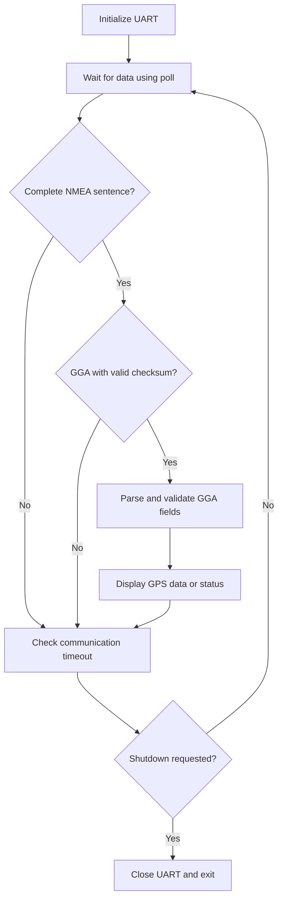

# GPS UART Monitor – BeagleBone Green

## Project Overview

A GPS monitoring application written in C for the BeagleBone Green running embedded Linux. The application receives NMEA sentences over UART, validates message checksums, parses GGA sentences, and displays positioning information in real time.

## Key Features

- UART communication using the Linux `termios` API.
- Support for `$GNGGA` and `$GPGGA` NMEA sentences.
- XOR-based NMEA checksum validation.
- Coordinate conversion from degrees and decimal minutes to decimal degrees.
- UTC time, fix quality, coordinate range and direction validation.
- Real-time terminal display of GPS positioning information.
- Communication timeout detection using `poll()` and `CLOCK_MONOTONIC`.
- Graceful shutdown using `SIGINT` (Ctrl+C).
- Configurable serial device at compile time for software testing.

## Hardware and Development Environment

- BeagleBone Green running Debian Linux
- OzzMaker BerryGPS-IMU-4 GPS module
- Jumper wires and USB cable
- Ubuntu Linux development environment
- GCC, SSH and SCP

### Hardware Connections

| GPS Module | BeagleBone Green | Description           |
|------------|------------------|-----------------------|
| TX         | P9_26 (UART1_RX) | GPS data transmission |  
| VCC        | P9_3 (3.3V)      | Power supply          |
| GND        | P9_1 (GND)       | Common ground         |

The GPS module continuously transmits NMEA sentences through its TX pin. The GPS RX pin is not required because the application only receives data.

### UART Configuration

| Parameter    | Value        |
|--------------|--------------| 
| Interface    | UART1        |
| Linux device | `/dev/ttyS1` |
| Baud rate    | 9600         |
| Data bits    | 8            |
| Parity       | None         |
| Stop bits    | 1            |
| Flow control | Disabled     |
| Mode         | Raw          |

## Software Architecture

| Function               | Responsibility                                                                                  |
|------------------------|-------------------------------------------------------------------------------------------------|
| `main()`               | UART initialization, data reception, sentence assembly, timeout monitoring and resource cleanup |
| `validate_checksum()`  | Validates the hexadecimal NMEA checksum using XOR                                               |
| `convert_coordinate()` | Converts coordinates to decimal degrees using `strtod()` and checks numeric ranges              |
| `process_gga()`        | Parses GGA fields, validates positioning data and displays GPS information                      |
| `handle_sigint()`      | Signals the main loop to terminate safely                                                       |

### Application Workflow



## NMEA Data Processing

The application processes GGA sentences to extract the following fields:

| Field                  | Description                      |
|------------------------|----------------------------------|
| UTC time               | GPS time in UTC                  |
| Latitude and longitude | Geographic coordinates           |
| Fix quality            | Positioning status               |    
| Satellites             | Number of satellites used        |
| HDOP                   | Horizontal dilution of precision |
| Altitude               | Height above mean sea level      |

Coordinates are converted using:

`Decimal degrees = Degrees + Minutes / 60`

Southern and western coordinates are represented as negative values.

## Error Handling

- Invalid NMEA checksums are ignored.
- Invalid UTC values and unsupported fix quality values are rejected.
- Invalid or missing coordinates are reported when a fix is indicated.
- A `NO FIX` status is displayed when the fix quality is zero.
- A communication warning is displayed when no checksum-valid GGA sentence arrives for approximately five seconds.
- UART and system call errors are handled with diagnostic messages and resource cleanup.

## Build and Run

Compile on the BeagleBone Green using GCC:

```bash
gcc -Wall -Wextra -Wpedantic -Werror gps_monitor.c -o gps_monitor
```

Run the application:

```bash
sudo ./gps_monitor
```

Press `Ctrl+C` to stop the application.

## Example Output

Illustrative GPS data:

```text
========================================
             GPS LIVE DATA
========================================
 UTC Time   : 12:34:56
 Latitude   : 48.117300 degrees
 Longitude  : 11.516667 degrees
 Satellites : 08
 HDOP       : 0.9
 Altitude   : 545.4 meters
 GPS Status : FIX OK
========================================
```

### Communication Timeout

```text
========================================
             GPS LIVE DATA
========================================
 GPS WARNING: No new GPS data received!
 Waiting for GPS connection...
========================================
```

## Testing

The initial implementation was successfully tested on BeagleBone Green with a physical GPS module, demonstrating UART reception, GGA parsing, live positioning updates, timeout detection and graceful shutdown.

The updated implementation compiles without warnings using strict GCC compiler flags. It also supports software testing through a Linux pseudo-terminal (PTY), allowing NMEA messages to be supplied without physical GPS hardware.

For PTY-based testing, the default serial device can be overridden at compile time (replace `/dev/pts/3` with the actual PTY slave path):

```bash
gcc -Wall -Wextra -Wpedantic -Werror \
    '-DGPS_DEVICE="/dev/pts/3"' gps_monitor.c -o gps_monitor
```

## Project Structure

```text
.
├── gps_monitor.c    # C source code
└── README.md        # Project documentation
```

## Technologies

C · Embedded Linux · UART · POSIX APIs · NMEA · GCC · Serial Communication · Signal Handling

